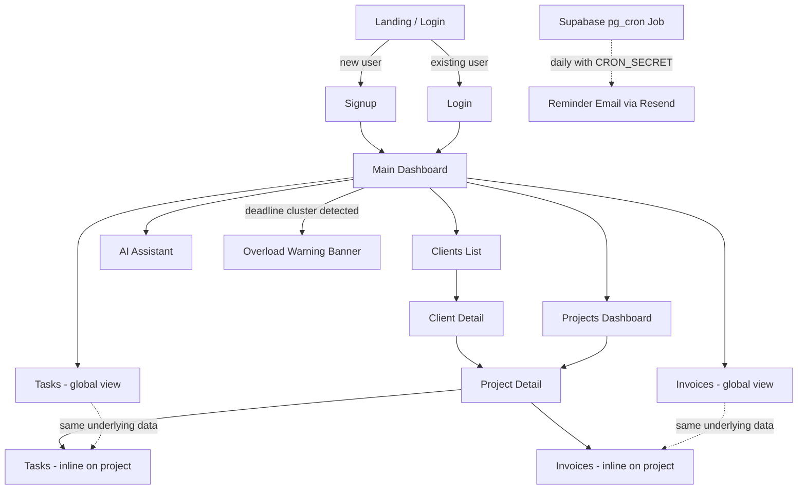

# AppFlow.md — WORKLEDGER

Screen-by-screen user flow. This describes what the user sees and does, and how screens connect — not implementation details (see TechSpec.md for that).

## 1. Flow Map (high level)

## 2. Auth Flow

**Entry point:** unauthenticated users land on `/login`.

1. **Login screen** — email + password fields, "Log in" button, link to Signup, link to "Forgot password."
2. **Signup screen** — email + password (+ confirm password), "Create account" button, link back to Login.
3. On successful login/signup → redirect to **Main Dashboard** (`/dashboard`).
4. On failed login → inline error message, stay on screen.
5. **Forgot password** → email input → Supabase sends reset link → user sets new password → redirect to Login.
6. Logout available from a persistent nav (top bar or sidebar) → clears session → redirect to `/login`.
7. All routes except `/login`, `/signup`, `/forgot-password` require an authenticated session; unauthenticated access redirects to `/login`.

## 3. Main Dashboard (`/dashboard`)

The landing page after login. Shows, top to bottom:

1. **Overload Warning banner** (only rendered if a cluster is detected: $\ge 3$ incomplete tasks due within the rolling 3-day window `today` through `today + 2 days` across $\ge 2$ distinct `Active` projects; overdue tasks excluded) — e.g. "⚠ 4 tasks due within 3 days across 3 active projects." Clicking it scrolls to / filters the Upcoming Deadlines section. Dismissible for the session via "×".
2. **Summary cards** (exactly 3 across on desktop, stacked on mobile):
   - **Active Projects** (count of projects where status = Active)
   - **Upcoming Deadlines** (count of incomplete tasks due from today through today + 7 days)
   - **Total Unpaid** (sum of unpaid invoices, INR currency-formatted)
3. **Active Projects list** — compact cards/rows: project name, client name, status pill, task progress (e.g. "3/7 done"), unpaid amount for that project. Clicking a project → Project Detail.
4. **Upcoming Deadlines list** — flat list of incomplete tasks due in next 7 days, sorted soonest first, each showing task title, due date, and parent project name (clickable → Project Detail). Overdue tasks (due before today, not done) are visually distinct (red) and pinned to the top of the list, rather than forming a separate summary card.
5. **Persistent nav** (sidebar or top bar) present on every authenticated screen, in fixed order: Dashboard, Clients, Projects, Tasks, Invoices, AI Assistant, Logout.
6. **AI Assistant entry point** — a nav item that opens the chat assistant (see Section 7).

## 4. Clients (`/clients`)

1. **Clients List** — table or card list of all clients: name, company, email. "Add Client" button top-right.
2. **Add/Edit Client** — modal or inline form: name (required), email, company, notes. Save → returns to Clients List with new/updated row visible.
3. **Client Detail** (`/clients/:id`) — shows client info plus a list of that client's projects (name, status, quick link). "Edit" and "Delete" actions.
4. **Delete Client** — if the client has any projects, deletion is blocked with a message: "This client has N project(s). Delete or reassign them first." If zero projects, confirm dialog → delete → return to Clients List.

## 5. Projects (`/projects`)

1. **Projects Dashboard** — all projects, grouped or filterable by status column (Planning / Active / Completed) — a simple 3-column view with a status dropdown on each card (per Design.md). "Add Project" button.
2. **Add/Edit Project** — form: name (required), client (dropdown, required), status (dropdown, defaults to Planning). Save → appears in the pipeline at the correct status.
3. **Change status** — from the dashboard (via status dropdown on the card) — Planning → Active → Completed. User can move freely between any of the three states.
4. **Project Detail** (`/projects/:id`) — the hub screen for one project:
   - Header: project name, client (link to Client Detail), status control, Edit/Delete project actions.
   - **Tasks section**: list of tasks (title, due date, done checkbox), "Add Task" inline form. Overdue/undone tasks visually flagged.
   - **Invoices section**: list of invoices (amount, date, paid/unpaid toggle), "Add Invoice" inline form.
5. **Delete Project** — if the project has any tasks or invoices, deletion is blocked with a message: "This project has tasks/invoices. Delete or reassign them first." (no cascade deletes in v1). If it has none, confirm dialog → delete → return to Projects Dashboard.

## 6. Tasks (`/tasks`) and Invoices (`/invoices`) — global screens, plus inline on Project Detail

Tasks and invoices are each manageable in two places, both reading/writing the same underlying data:

**Inline on Project Detail** (scoped to one project):
- Add task: title + due date → appears in the project's task list.
- Toggle done/not done: single click/checkbox, updates immediately (optimistic UI acceptable).
- Edit task: dialog/form allowing updates to title, due date, and **Project reassignment** (dropdown populated with the current user's projects). This allows tasks to be moved to another project before deleting the parent project. Reassigning to another user's project is blocked.
- Delete task: trash icon on task row.
- Add/edit/delete invoice the same way: Invoices section of Project Detail. Editing an invoice includes amount, date, paid status, and **Project reassignment** (dropdown of user's projects).

**Global Tasks screen** (`/tasks`, cross-project):
- Flat list of every task across every project, with the parent project name shown per row (clickable → Project Detail).
- Filter/sort by due date, done/not done, and project.
- Same add/toggle/edit/delete actions as the inline version (including Project dropdown on edit).

**Global Invoices screen** (`/invoices`, cross-project):
- Flat list of every invoice across every project, with the parent project name shown per row (clickable → Project Detail).
- Filter/sort by paid/unpaid status and date.
- Same add/toggle/edit/delete actions as the inline version (including Project dropdown on edit).

Tasks feed the Main Dashboard's "Upcoming Deadlines" and the Overload Warning logic regardless of which screen was used to create/edit them.

## 7. AI Assistant

1. Opens as a **slide-over panel or modal** (not a full page navigation) so the user can ask a question without losing their place — accessible from any authenticated screen via nav item or floating button.
2. Simple chat UI: message history (user + assistant turns), text input, "Send" button.
3. On send: frontend sends the question to `/api/ai/ask`; backend verifies user session, fetches the current user's data from Supabase, packages it as context, and calls the Claude API; returns answer and renders in the chat panel.
4. Assistant answers only — no buttons to create/edit records from chat in v1.
5. Chat history does not need to persist across sessions in v1 (in-memory for the session is sufficient).
6. Empty state: a few suggested example questions shown before the user's first message (e.g. "How much am I owed?", "What's due this week?").

## 8. Error / Empty States (applies across screens)

- **No clients yet**: Clients List shows an empty state with a prompt to add the first client.
- **No projects yet**: Projects Dashboard shows an empty state with a prompt to add the first project (disabled/hinted if no clients exist yet, since a project requires a client).
- **No tasks/invoices on a project**: Project Detail shows a lightweight empty state per section, not an error.
- **Global Tasks/Invoices screens with nothing yet**: same lightweight empty-state pattern, prompting the user to add a project first if none exist yet.
- **Dashboard with no active projects**: summary cards show zero states; no Overload Warning; Upcoming Deadlines shows "Nothing due — you're clear."
- **AI Assistant with no data at all**: assistant should say so plainly rather than fabricate an answer (e.g. "You don't have any projects yet, so I don't have anything to report on.").
